# Interaction State Machines

## Method and limitations

These states were exercised on one Quanta article route with isolated Chrome 155 (Playwright 1.64.1), desktop 1440×900 and mobile 390×844. Cookie settings and any browser state existed only in disposable contexts. REA's independent controlled launch captured the Quanta page at desktop (`ev_c706695240da8462a198d60557a6be8e708616409bf5b8a082928ac2ca836d6c`). Knowable could not be exercised past its 403 Cloudflare verification page; no protection was bypassed.

## Quanta full-screen navigation

Observed initial DOM: `button[aria-label="open the menu"][aria-haspopup="menu"]`; a `div[role="menu"]` already exists but is initially `visibility:hidden`, `opacity:0`. It has 24 links/button-like descendants.

| State / event | Observed result | Confidence |
|---|---|---|
| Initial page | Menu hidden; focus at body | High, one route |
| Click “open the menu” | Fixed full-viewport panel becomes visible; opacity transition reaches 1; focus remains on trigger | High, desktop and mobile |
| Press Escape after opening | Menu remained visible after 700 ms; focus remained on trigger | Medium-high, repeated desktop/mobile; likely escape-dismissal gap |
| Press Tab afterward | Focus moved to an anchor inside the panel; menu remained visible | High for this sequence |
| Click outside | Earlier exploratory sequence did not dismiss it; full-viewport panel overlays the page | Medium; target may have landed on overlay |
| Close control | Not isolated from the menu in this run | Unknown |

The publisher declares `role=menu`, but the observed Tab movement to a link resembles ordinary disclosure/dialog navigation rather than the ARIA menu arrow-key model. Do not adopt the role blindly. ScientificRadar's menu should use either a disclosure `<nav>` with normal Tab sequence or a true ARIA menu with the complete arrow-key model; for ordinary site links, disclosure navigation is preferred.

### Reference observation state diagram

```mermaid
stateDiagram-v2
  [*] --> Closed
  Closed: role=menu hidden / opacity 0
  Closed --> Opening: click menu button
  Opening --> Open: transition settles / fixed viewport panel
  Open --> Open: Escape (observed; no dismissal)
  Open --> Open: Tab (focus enters first link)
  Open --> UnknownClose: close control not isolated
```

## Original menu acceptance state machine

```mermaid
stateDiagram-v2
  [*] --> Closed
  Closed --> Open: activate menu button
  Open --> Closed: activate close button
  Open --> Closed: Escape
  Open --> Closed: select route
  Open --> Closed: click backdrop (if modal)
  Closed: aria-expanded=false; focus on trigger
  Open: aria-expanded=true; focus managed; background inert only if modal
  Closed --> Closed: resize across breakpoint; focus remains valid
```

Implementation details: `aria-controls` references the panel; initial focus goes to the first nav link only when modal behavior is chosen; close/Escape returns focus to the opener; route selection closes before navigation; reduced motion disables opacity/transform transitions; closing restores document scroll position and `overflow`.

## Search behavior

No search state was confirmed in this phase: visible utility controls included unnamed icon buttons, and a search trigger was not reliably identified by accessible name. The UI therefore remains an implementation recommendation. Define explicit states `Closed → Open → Submitting → Results/Empty/Error`; focus the search input on open; Enter submits; Escape closes and returns focus; preserve query in URL `/search?q=`; keep the form usable with keyboard and screen readers.

## Client navigation, loading, and lazy media

A route load returned HTTP 200 and the page DOM was available at `DOMContentLoaded`; this does not establish whether navigation between internal routes is client-side. The page had images, videos, and iframes; their presence alone does not prove lazy loading or successful third-party playback. Browser resource manifests and full JavaScript bundles were deliberately not reconstructed. No test established route transition timing, scroll restoration, or history behavior.

## Knowable

Unobserved due to Cloudflare verification. Do not fill the gap with guessed menu behavior. The exact browser-origin documentation differentiates passive CDP observation from a controlled launch scenario. This audit used launch mode; see [REA's scenario contract](https://github.com/morluto/rea/blob/main/docs/browser-scenario-contract.md).
